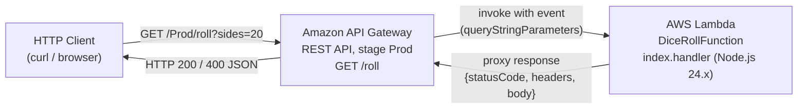
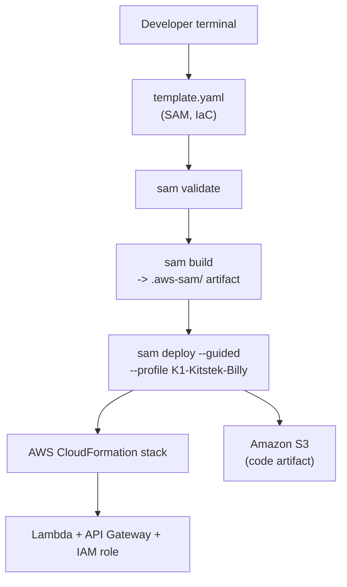

# Design Document

## Overview

The Dice Roll API is a serverless HTTP API on AWS. A single public endpoint, `GET /roll`, rolls a virtual die with a caller-specified number of sides and returns the result as JSON. The system is composed of two managed AWS services wired together by Infrastructure as Code:

- **AWS Lambda** runs the roll logic on demand (Node.js 24.x, ESM). No servers to provision, patch, or scale manually.
- **Amazon API Gateway** (REST, proxy integration) gives the function a public HTTPS URL, routes `GET /roll` to it, and marshals the request/response.

Everything is declared in a single AWS SAM template (`template.yaml`) and deployed with the SAM CLI. The design intentionally keeps all request-handling logic inside the Lambda handler as a pure, synchronously computable function so it can be unit- and property-tested locally without any AWS dependencies.

Design goals, mapped to the requirements:

- Correct, bounded, uniformly random rolls with sensible defaulting (Requirements 1, 2).
- Explicit validation with a clear client error for out-of-range input (Requirement 3).
- A reachable, unauthenticated public endpoint (Requirement 4).
- Repeatable, shareable, reversible deployment via SAM IaC (Requirements 5, 6, 7, 9).
- All AWS-interacting commands authenticated with the `K1-Kitstek-Billy` profile (Requirement 8).

## Architecture

The runtime path is a straight line: an HTTP client sends a request, API Gateway routes and invokes the function, Lambda computes a roll and returns a proxy-shaped response, and API Gateway relays it back.



### Deployment / build architecture

The build and deploy flow is driven entirely by the SAM CLI operating on `template.yaml`.



### Key architectural decisions

- **API Gateway proxy integration (implicit API).** Declaring an `Api` event on the function makes SAM generate the REST API, the `/roll` resource, the `GET` method, and the `Prod` stage automatically (Requirements 4.1, 5.5). This avoids a hand-written `AWS::Serverless::Api` resource and keeps the template minimal. The trade-off is less fine-grained control over the API, which this project does not need.
- **All logic in a pure handler.** The handler reads only from the `event` object and returns a plain response object. It performs no I/O, has no external dependencies, and is deterministic except for `Math.random()`. This makes it directly testable in Node.js by importing the handler and passing synthetic events (Requirement 6.3), and makes the roll bounds property-testable.
- **No authentication.** The endpoint is public by design (Requirement 4.5). API Gateway's default account-level throttling provides basic abuse protection; no custom authorizer is configured.
- **Named profile for AWS interactions.** Deployment and teardown commands pass `--profile K1-Kitstek-Billy` so resources land in the intended account (Requirement 8). Local-only commands (`sam validate`, `sam build`) do not require it.

## Components and Interfaces

### 1. Dice_Roll_Function (AWS Lambda)

- **Source:** `dice-roll-api/lambda/index.mjs` (Requirement 6.1)
- **Runtime:** Node.js 24.x, ECMAScript Modules (`.mjs`)
- **Handler:** `index.handler` — an exported `async` function taking a single `event` argument (Requirements 5.2, 6.3)

Responsibilities:

1. Read `event.queryStringParameters`, treating absent/`null` as an empty object (Requirements 6.4, 6.5).
2. Resolve `Sides`: `parseInt(params.sides) || 6`. `parseInt` truncates fractional strings toward zero (Requirement 1.3); the `|| 6` fallback covers absent, empty, non-numeric, and `0` values (Requirements 2.1-2.4).
3. Validate: if `Sides < 2` or `Sides > 100`, return HTTP 400 (Requirements 3.2, 3.3).
4. Compute the roll: `Math.floor(Math.random() * sides) + 1`, yielding a uniform integer in `[1, Sides]` (Requirement 1.1).
5. Return an API Gateway proxy response object (Requirements 1.4, 1.5, 3.4, 3.5).

Handler interface:

```javascript
// lambda/index.mjs
export const handler = async (event) => {
  const params = event.queryStringParameters || {};
  const sides = parseInt(params.sides) || 6;

  if (sides < 2 || sides > 100) {
    return {
      statusCode: 400,
      headers: { "Content-Type": "application/json" },
      body: JSON.stringify({ error: "Sides must be between 2 and 100." }),
    };
  }

  const result = Math.floor(Math.random() * sides) + 1;

  return {
    statusCode: 200,
    headers: { "Content-Type": "application/json" },
    body: JSON.stringify({ sides: sides, roll: result }),
  };
};
```

A note on the `|| 6` defaulting: because `parseInt("0")` is `0` (falsy), a `sides=0` request resolves to `6` rather than failing validation (Requirement 2.4). `parseInt` also tolerates trailing non-numeric characters (e.g. `"20abc"` -> `20`) and leading whitespace, which keeps the function robust against malformed query strings without an unhandled error (Requirement 6.5).

### 2. API_Gateway_Endpoint (Amazon API Gateway REST)

- Created implicitly by SAM from the function's `Api` event.
- Exposes `GET /roll` under stage `Prod` only (Requirement 4.1).
- Uses Lambda proxy integration: the full HTTP request is passed to the function as an `event`, and the function's returned object maps directly to the HTTP response (Requirement 4.2).
- Methods other than `GET` on `/roll` are rejected by API Gateway with a method-not-allowed error, since only the `get` method is wired (Requirement 4.4).
- If the function errors or times out, API Gateway returns a 5xx error to the caller (Requirement 4.3).
- No authorizer configured; open to any caller with the URL (Requirement 4.5).

### 3. SAM_Template (template.yaml)

- **Path:** `dice-roll-api/template.yaml` (Requirement 6.2)
- Declares `Transform: AWS::Serverless-2016-10-31` (Requirement 5.1).
- Defines `DiceRollFunction` with handler, runtime, `CodeUri: lambda/`, `Timeout: 5`, `MemorySize: 128`, and the `/roll` `get` API event (Requirements 5.2-5.5).
- Exposes the endpoint URL via `Outputs` (Requirement 5.6).

Template:

```yaml
AWSTemplateFormatVersion: '2010-09-09'
Transform: AWS::Serverless-2016-10-31
Description: Dice Roll API - A serverless API that rolls dice

Resources:
  DiceRollFunction:
    Type: AWS::Serverless::Function
    Properties:
      Handler: index.handler
      Runtime: nodejs24.x
      CodeUri: lambda/
      Timeout: 5
      MemorySize: 128
      Events:
        RollDice:
          Type: Api
          Properties:
            Path: /roll
            Method: get

Outputs:
  DiceRollApi:
    Description: API Gateway endpoint URL
    Value: !Sub "https://${ServerlessRestApi}.execute-api.${AWS::Region}.amazonaws.com/Prod/roll"
```

`ServerlessRestApi` is the logical ID SAM assigns to the implicitly created REST API, so the `Outputs` value resolves to the live URL after deployment (Requirements 5.6, 7.5).

### 4. SAM_CLI workflow (deployment interface)

| Command | Purpose | Profile required |
|---|---|---|
| `sam validate` | Check template syntax/structure (Requirement 7.1, 7.2) | No (local-only, Requirement 8.3) |
| `sam build` | Package function into `.aws-sam/` artifact (Requirement 7.3, 7.4) | No (local-only, Requirement 8.3) |
| `sam deploy --guided --profile K1-Kitstek-Billy` | Create stack and resources, print URL (Requirement 7.5-7.7, 8.1) | Yes |
| `sam delete --profile K1-Kitstek-Billy` | Tear down the stack (Requirement 9) | Yes |

The guided deploy prompts write a `samconfig.toml` so subsequent deploys can run without `--guided`.

## Data Models

### Request (inbound to handler via API Gateway event)

The handler consumes only one field of the API Gateway proxy event:

```jsonc
{
  "queryStringParameters": { "sides": "20" }   // may be null or absent
}
```

- `queryStringParameters`: object of string-valued query params, or `null`/absent when none supplied (Requirements 6.4, 6.5).
- `sides`: optional string. Parsed with `parseInt`; truncates fractions, tolerates trailing junk, falls back to `6` when falsy/unparseable (Requirements 1.3, 2.1-2.4).

### Resolved internal values

| Name | Type | Derivation | Constraint |
|---|---|---|---|
| `Sides` | integer | `parseInt(params.sides) \|\| 6` | valid range `[2, 100]` |
| `Roll` | integer | `Math.floor(Math.random() * Sides) + 1` | `1 <= Roll <= Sides` |

### Success response (HTTP 200)

```json
{
  "statusCode": 200,
  "headers": { "Content-Type": "application/json" },
  "body": "{\"sides\":20,\"roll\":17}"
}
```

Decoded body (Requirement 1.5):

```json
{ "sides": 20, "roll": 17 }
```

### Error response (HTTP 400)

```json
{
  "statusCode": 400,
  "headers": { "Content-Type": "application/json" },
  "body": "{\"error\":\"Sides must be between 2 and 100.\"}"
}
```

Decoded body (Requirement 3.5):

```json
{ "error": "Sides must be between 2 and 100." }
```

In all cases the `body` is a JSON-stringified object and `Content-Type` is `application/json` (Requirements 1.4, 3.4).

## Correctness Properties

*A property is a characteristic or behavior that should hold true across all valid executions of a system - essentially, a formal statement about what the system should do. Properties serve as the bridge between human-readable specifications and machine-verifiable correctness guarantees.*

The Dice Roll handler is a pure function of its event input (deterministic except for `Math.random()`), which makes its input/output contract an ideal fit for property-based testing. The properties below are derived from the prework analysis. Overlapping acceptance criteria describing the same success, defaulting, and error behaviors have been consolidated into single comprehensive properties.

### Property 1: Valid sides produce a bounded roll in a well-formed 200 response

*For any* integer `n` in the range `[2, 100]`, invoking the handler with an event whose `queryStringParameters.sides` is the string form of `n` SHALL return a response with `statusCode` 200, header `Content-Type` equal to `application/json`, and a body that parses as JSON to an object whose `sides` equals `n` and whose `roll` is an integer satisfying `1 <= roll <= n`.

**Validates: Requirements 1.1, 1.4, 1.5, 3.1**

### Property 2: Falsy or unparseable sides defaults to a six-sided successful roll

*For any* event in which `sides` is absent, an empty string, a non-numeric string, the string `"0"`, or whose `queryStringParameters` is absent or `null`, invoking the handler SHALL return `statusCode` 200 with a body that parses to an object where `sides` equals 6, `roll` is an integer satisfying `1 <= roll <= 6`, and no `error` field is present.

**Validates: Requirements 1.2, 2.1, 2.2, 2.3, 2.4, 2.5, 6.5**

### Property 3: Fractional sides strings truncate toward zero

*For any* integer `n` in `[2, 100]` and any fractional component, invoking the handler with `sides` set to the decimal string `"n.fraction"` SHALL resolve `sides` to `n` (the truncated integer part) in the returned body.

**Validates: Requirements 1.3**

### Property 4: Out-of-range sides produce the standard 400 error

*For any* integer `n` that parses truthy and lies outside `[2, 100]` (that is, `n == 1` or `n < 0` or `n > 100`), invoking the handler with `sides` set to the string form of `n` SHALL return a response with `statusCode` 400, header `Content-Type` equal to `application/json`, and a body that parses to an object whose `error` equals exactly `Sides must be between 2 and 100.`.

**Validates: Requirements 3.2, 3.3, 3.4, 3.5**

### Property 5: Every response body is valid JSON

*For any* event input (valid, defaulting, or out-of-range), the handler SHALL return an object whose `body` is a string that successfully parses as JSON and whose `headers.Content-Type` is `application/json`.

**Validates: Requirements 1.4, 1.5, 3.4, 3.5**

## Error Handling

| Condition | Where handled | Behavior | Requirement |
|---|---|---|---|
| `sides` out of `[2, 100]` (truthy) | Lambda handler | Return HTTP 400 with `{ "error": "Sides must be between 2 and 100." }`, `Content-Type: application/json` | 3.2, 3.3, 3.4, 3.5 |
| `sides` absent/empty/unparseable/`0` | Lambda handler | Default to 6 and roll normally (not an error) | 2.1-2.5 |
| `queryStringParameters` absent or `null` | Lambda handler | `|| {}` fallback; treat as empty, no unhandled error | 6.5 |
| Handler throws / times out (>5s) | API Gateway | Returns a 5xx error to the caller | 4.3 |
| Non-GET method on `/roll` | API Gateway | Method-not-allowed error (only `get` is wired) | 4.4 |
| Invalid template | SAM CLI (`sam validate`) | Non-zero exit, error identifying the offending resource | 5.7, 7.2 |
| Build failure | SAM CLI (`sam build`) | Non-zero exit, no artifact produced | 7.4 |
| Resource creation failure | SAM CLI / CloudFormation | Non-zero exit, rollback of created resources | 7.6 |
| Deletion failure | SAM CLI (`sam delete`) | Non-zero exit, error identifying the resource | 9.4 |

The handler itself has no throwing code paths under normal input: the `|| {}` and `|| 6` fallbacks guarantee that any event shape resolves to either a valid roll or a validation 400. Beyond the handler, infrastructure-level errors are delegated to API Gateway and CloudFormation, which this design relies on rather than reimplements.

## Testing Strategy

Testing is split by what is being verified. The handler's logic is pure and input-driven, so it is covered by property-based tests. Everything else - the SAM template, API Gateway wiring, and deployment lifecycle - is infrastructure and tooling behavior verified by validation, snapshot/static checks, and a small number of integration/smoke checks. We do not property-test AWS service behavior.

### Local test setup

The handler can be tested entirely in Node.js with no AWS access by importing the exported `handler` and passing synthetic API Gateway event objects:

```javascript
import { handler } from "../lambda/index.mjs";

const res = await handler({ queryStringParameters: { sides: "20" } });
const body = JSON.parse(res.body);
```

Recommended lightweight setup:

- **Test runner:** `node:test` (built into Node.js 24, zero dependencies) or `vitest` if a richer DX is preferred.
- **Property-based testing library:** `fast-check` (the de facto standard for JS/TS). We do not implement property generation from scratch.
- Place tests under `dice-roll-api/tests/` (e.g. `handler.test.mjs`). Add a `package.json` with a `test` script and `fast-check` as a dev dependency. Keeping test files out of `lambda/` avoids shipping test code in the deployment artifact.

Run tests with a single-execution command (for example `node --test` or `vitest --run`), not watch mode.

### Property-based tests (handler logic)

Each correctness property is implemented by exactly one property-based test, configured for a minimum of 100 iterations, and tagged with a comment referencing the design property.

| Property | Generator strategy |
|---|---|
| P1 Valid roll | `fc.integer({ min: 2, max: 100 })`, pass as `String(n)` |
| P2 Defaulting | `fc.oneof` of: missing `sides`, `""`, non-numeric strings, `"0"`, and events with absent/`null` `queryStringParameters` |
| P3 Fractional truncation | `fc.integer({ min: 2, max: 100 })` + `fc.integer({ min: 0, max: 999 })` composed into `"n.fraction"` |
| P4 Out-of-range error | `fc.oneof(fc.constant(1), fc.integer({ min: -1000, max: 0 }).filter(truthy), fc.integer({ min: 101, max: 10000 }))` |
| P5 Valid JSON body | `fc.oneof` spanning all three branches above |

Tag format for each property test:

```javascript
// Feature: dice-roll-api, Property 1: Valid sides produce a bounded roll in a well-formed 200 response
import fc from "fast-check";
import { test } from "node:test";
import assert from "node:assert/strict";
import { handler } from "../lambda/index.mjs";

test("P1: valid sides roll within bounds", async () => {
  await fc.assert(
    fc.asyncProperty(fc.integer({ min: 2, max: 100 }), async (n) => {
      const res = await handler({ queryStringParameters: { sides: String(n) } });
      assert.equal(res.statusCode, 200);
      assert.equal(res.headers["Content-Type"], "application/json");
      const body = JSON.parse(res.body);
      assert.equal(body.sides, n);
      assert.ok(Number.isInteger(body.roll) && body.roll >= 1 && body.roll <= n);
    }),
    { numRuns: 100 }
  );
});
```

### Unit / example tests (handler structure)

A few concrete example tests complement the property tests:

- `sides=0` resolves to 6 (explicit edge of the `|| 6` fallback, Requirement 2.4).
- Event with `queryStringParameters: null` returns a 200 default roll without throwing (Requirement 6.5).
- The module exports a `handler` that is a function and returns a Promise - confirming the async ESM named-export contract (Requirement 6.3).

### Infrastructure and deployment verification (not property-tested)

These are IaC and external-tooling concerns. Property-based testing does not apply; they are verified by static checks and one-shot integration/smoke runs.

- **Template static/smoke checks (Requirements 5.1-5.5, 6.1, 6.2, 8):** confirm the two source files exist at their expected paths, and that `template.yaml` declares the transform, function type/handler/runtime/`CodeUri`, `Timeout: 5`, `MemorySize: 128`, and the `/roll` `get` event. `sam validate` covers structural correctness (Requirements 7.1, 7.2, 5.7).
- **Build (Requirement 7.3, 7.4):** `sam build` succeeds and produces the `.aws-sam/` artifact.
- **Deploy + endpoint integration (Requirements 4.1, 4.2, 4.5, 5.6, 7.5-7.7):** run `sam deploy --guided --profile K1-Kitstek-Billy`, then `curl` the reported HTTPS URL:
  - `GET /Prod/roll?sides=12` -> 200 JSON with `sides: 12`.
  - `GET /Prod/roll` -> 200 JSON with `sides: 6`.
  - `GET /Prod/roll?sides=1` -> 400 with the standard error message.
  - A non-GET method (e.g. `POST`) -> method-not-allowed error (Requirement 4.4).
- **Teardown (Requirement 9):** `sam delete --profile K1-Kitstek-Billy` removes the stack and reports progress.

### AWS profile requirement

Every AWS-interacting command MUST include `--profile K1-Kitstek-Billy` (Requirements 8.1, 8.2): this applies to `sam deploy` and `sam delete`, and to any `aws` CLI invocation used to inspect resources. The local-only commands `sam validate` and `sam build` do not interact with AWS and may be run with or without the profile, producing identical results (Requirement 8.3).
